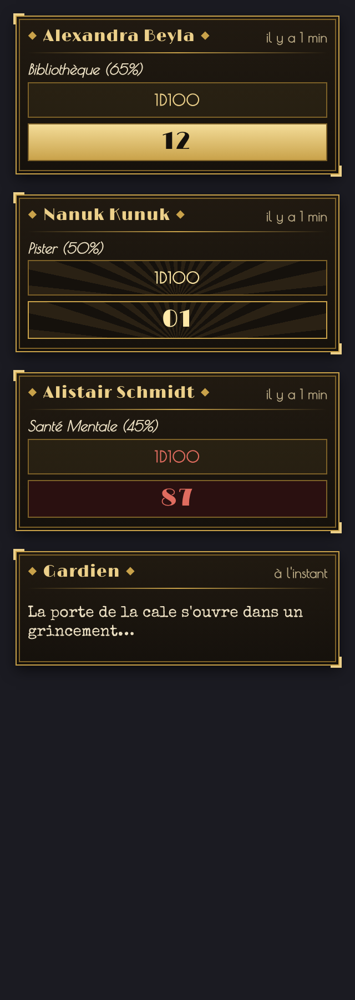
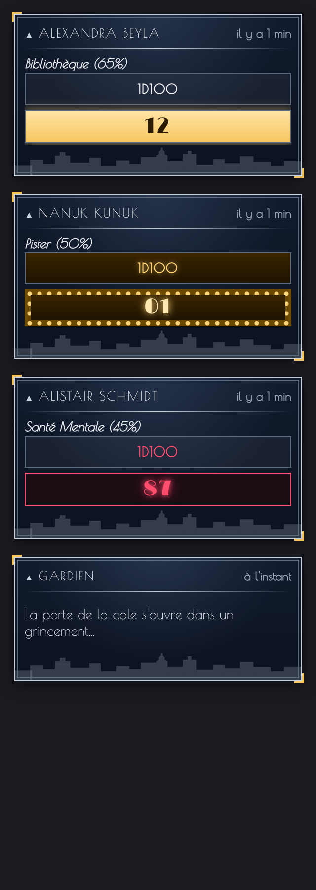
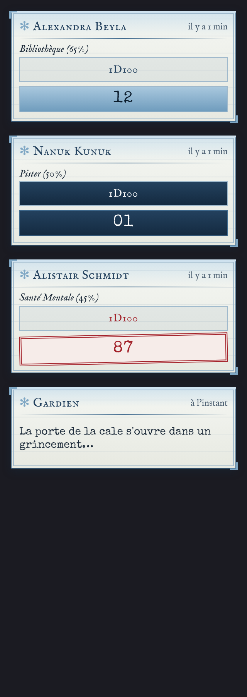
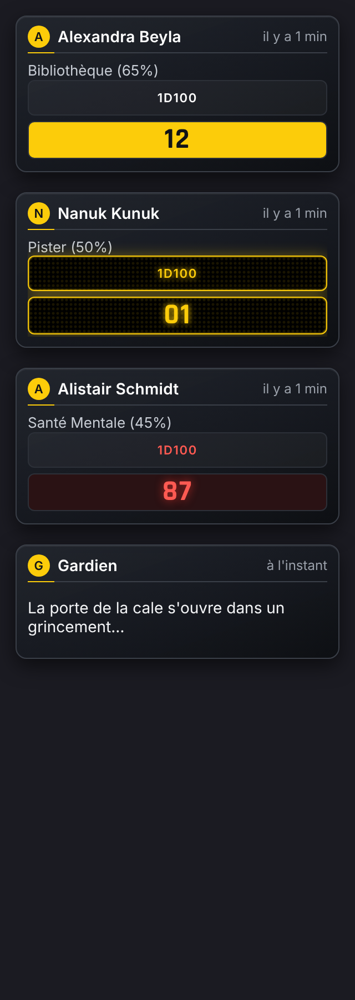
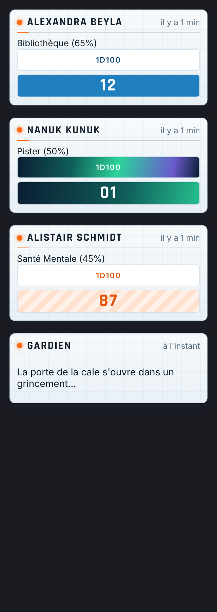

# CoC7 – Cartes de chat thématiques

Habille le chat de Foundry VTT et les **cartes de jets de L'Appel de Cthulhu v7** (système CoC7) d'un thème d'ambiance. Seule l'apparence change : aucune carte, aucun jet n'est modifié.

| Années 20 | New York années 20 | Par-delà les Montagnes Hallucinées |
| --- | --- | --- |
|  |  |  |

## Les thèmes

- **Années 20 (Art Déco noir et or)** : assorti au thème Années 20 de Combat Cthulhu HUD et de Token Action HUD. Noms en Limelight, filets dorés, chiffres en cartouches or ; la réussite critique s'affiche sur un soleil Art Déco.
- **New York années 20 (Manhattan, Broadway)** : bleu nuit et chrome argenté façon Chrysler Building, silhouette de gratte-ciels au bas de chaque carte, noms en capitales espacées. La réussite extrême brille comme une enseigne, la critique s'entoure d'ampoules de marquise de Broadway qui scintillent, les échecs s'allument en néon rouge.
- **Par-delà les Montagnes Hallucinées (carnet d'expédition)** : papier ligné et givré de l'expédition Miskatonic (1930-1931), encre bleu marine, titres en caractères anciens, chiffres à la machine à écrire. Les échecs reçoivent un tampon rouge d'archive.
- **New York 2026 (verre, LED et métro)** : verre fumé, typographie suisse, pastille de métro avec l'initiale du personnage ; niveaux de réussite aux couleurs des lignes (bleu, vert, jaune), critique en afficheur LED, échecs en rouge lumineux.
- **Antarctique 2026 (station de recherche polaire)** : tablette de station, blanc glacier sur quadrillage, orange sécurité, chiffres de télémétrie ; critique en aurore australe, échecs hachurés orange.
- **Aucun** : le style d'origine de CoC7.

| New York 2026 | Antarctique 2026 |
| --- | --- |
|  |  |

Le niveau de réussite reste lisible d'un coup d'œil : couleur différente pour ordinaire, majeure, extrême, critique, échec et maladresse.

## Réglages

| Réglage | Portée | Rôle |
| --- | --- | --- |
| Thème des cartes du chat | Personnel | Chaque joueur choisit son thème (par défaut : Années 20). |
| Thème imposé à toute la table | Monde (Gardien) | « Laisser chacun choisir », ou un thème appliqué à tous les joueurs. |
| Appliquer aussi au HUD de combat et à Token Action HUD | Personnel | Coché par défaut : le même thème est appliqué à Combat Cthulhu HUD (0.4.0 ou plus) et à Token Action HUD (module *Token Action HUD – Thèmes années 20*). |

## Une table cohérente

Avec la synchronisation, **un seul réglage** habille tout : le chat, le HUD de combat et Token Action HUD. Le Gardien peut imposer le thème à tous depuis ce module.

Dans Combat Cthulhu HUD, les résultats et les boutons des cartes suivent le thème du chat ; le cadre des cartes suit le thème du HUD.

## Installation

Dans **Modules complémentaires › Installer un module**, collez ce lien de manifeste :

```
https://github.com/magisterphamtom/coc7-cartes-chat/releases/latest/download/module.json
```

## Compatibilité

Foundry VTT 13 et 14 (vérifié en 14.368), système CoC7 8.14 ou plus (vérifié en 8.15).

## Crédits et licence

Code et styles : **magisterphamtom**, licence MIT.
Polices incluses : Limelight, Poiret One, IM Fell English, Inter et Rajdhani (SIL Open Font License 1.1) et Special Elite (Apache 2.0) — licences dans `fonts/`.
Call of Cthulhu est une marque déposée de Chaosium Inc. Ce module n'est pas affilié à Chaosium.
